# Audio-Visual Speech Recognition under Noise

**English** | [简体中文](README.zh-CN.md)

**Recognising a spoken name from the voice and the lips, and finding out when the lips actually help.**
The signal-processing front-ends are hand-built (MFCC and lip-DCT), every stream uses the same temporal CNN (implemented in both PyTorch and Keras/TensorFlow, with verified parity), and the evaluation covers acoustic noise, unseen video degradation and early vs. late fusion, plus an analysis of a recording-session confound in the data.

[](https://github.com/cpg25ncu/audio-visual-speech-recognition/actions/workflows/ci.yml)


<p align="center">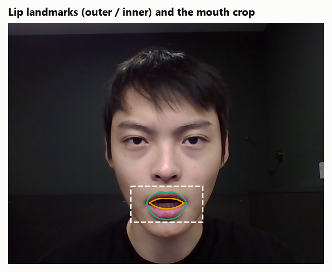
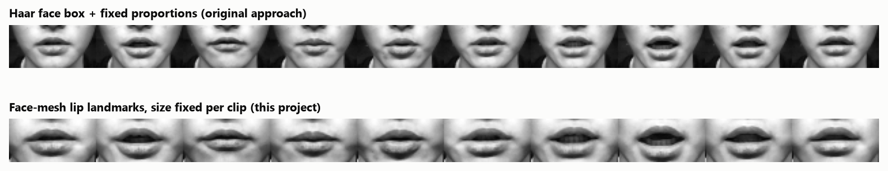</p>

The task is speaker-dependent isolated-word recognition: 20 first names, 600 smartphone clips of one speaker, a fixed 18/6/6 split per name and 5 training seeds per configuration. Every number below is produced by `avsr run all && avsr report`; see [`results/tables/RESULTS.md`](results/tables/RESULTS.md) for all tables.

## Key results

| | |
|---|---|
| **Noise-robust audio** | Multi-condition training raises accuracy at 0 dB SNR (mean of white, pink, babble and room noise) from **30.5% → 77.7%**. Spectral subtraction gives 30.7%. Babble (competing speech) remains the hard case: 16% at 0 dB. |
| **Lip reading** | Landmark-tracked mouth crop + 2D-DCT + temporal CNN: **100%** on clean video and 85.5% on moderately degraded video it never saw. The original coursework pipeline (Haar crop, time-averaged DCT, MLP) scores 94.8% and 16.8%. |
| **Fewer coefficients, more robustness** | On degraded video, 10 DCT coefficients reach 100% while 150 reach 23%. High spatial frequencies are exactly what blur and sensor noise destroy. |
| **Fusion** | With clean video, fusion holds **~100% down to −10 dB**, where audio alone gives 47%. With severely degraded video (unseen), early fusion collapses to 30% even on clean audio; entropy-weighted late fusion falls back to audio automatically (100% clean, 78% at 0 dB). |
| **Where adaptive fusion fails** | Babble makes the audio recogniser *confidently* wrong, so entropy-based reliability trusts it: 37% at 0 dB with moderate video, against 87% for an oracle weight. |
| **Confound check** | Each name was recorded as one block, and a classifier can identify the block from the lips *at rest* (83%). The deployed lip reader does not use this shortcut: with the word masked out it is at chance (7.5%). |
| **Two frameworks** | Every main system was implemented and trained in both **PyTorch and Keras/TensorFlow** with identical parameter counts. Across 30 system/condition pairs the frameworks differ by at most 1.6 points, always within the seed-to-seed spread. Exports cover ONNX and TFLite (int8: 3.7× smaller, 3.6× faster, same accuracy). |

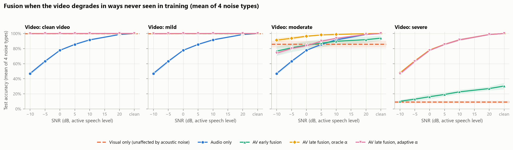

## How it works

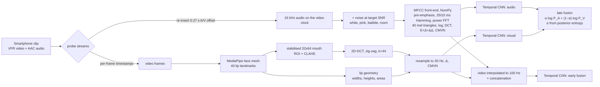

* **Audio.** Filterbank-cepstral features written from first principles and unit-tested against librosa (the mel filterbank matches to 1e-5). Noise is mixed at a controlled *active-speech-level* SNR, and three compensation methods are compared: spectral subtraction, multi-condition training and CMVN.
* **Video.** Frames are decoded with their true timestamps (the phone recorded variable frame rate), and the mouth crop is stabilised by face-mesh landmarks. Features are appearance (2D-DCT, block-DCT, PCA), geometry (lip shape) or learnt (ROI-CNN).
* **One model family.** A dilated 1-D temporal CNN with mean+max pooling over time is used for audio, video and fused input, so comparisons isolate the input. About 0.3–0.4 M parameters; each model trains in a few seconds on a laptop GPU.
* **Fusion.** Early fusion concatenates features after up-sampling video to the audio frame rate. Late fusion combines posteriors log-linearly with a global, an oracle (per condition) or an entropy-based adaptive stream weight.

## Two frameworks: PyTorch and Keras

PyTorch is the default. The same models and training protocol are also implemented in **Keras 3 (TensorFlow backend)**; `--backend` switches between them:

```bash
avsr run audio --backend keras                # rerun the audio experiment with Keras
avsr run framework_parity --backend keras     # train every main system in Keras, compare with PyTorch
```

* **One interface.** [`backends.py`](src/avsr/backends.py) defines what a framework has to do: build a model, train it, return posteriors and save it. Features, noise, splits, scoring and late fusion only see NumPy arrays and posteriors, so a Keras audio model can be fused with a PyTorch lip reader.
* **Matched layer by layer.** [`keras_models.py`](src/avsr/keras_models.py) mirrors the PyTorch architectures, and the trainable-parameter counts are identical (a unit test asserts it). The framework differences that matter are handled explicitly:
  * channels-first vs. channels-last layout;
  * the opposite meaning of batch-norm `momentum` (PyTorch 0.1 = Keras 0.9);
  * PyTorch's U(±1/√fan_in) initialisation instead of Keras' Glorot/zeros;
  * global rather than per-tensor gradient clipping;
  * AdamW epsilon.
* **Idiomatic Keras.** [`keras_training.py`](src/avsr/keras_training.py) uses Keras' own building blocks:
  * a `keras.utils.PyDataset` that re-shuffles and re-draws noisy versions every epoch;
  * augmentation as a custom layer that is active only in training;
  * a `LearningRateSchedule` reproducing PyTorch's `OneCycleLR` (unit-tested step by step);
  * the accuracy-then-log-loss early stopping as a callback.
* **Deployment.** [`export.py`](src/avsr/export.py) exports PyTorch to ONNX (checked against ONNX Runtime) and Keras to TFLite (float32, float16, dynamic-range int8, full-integer int8).

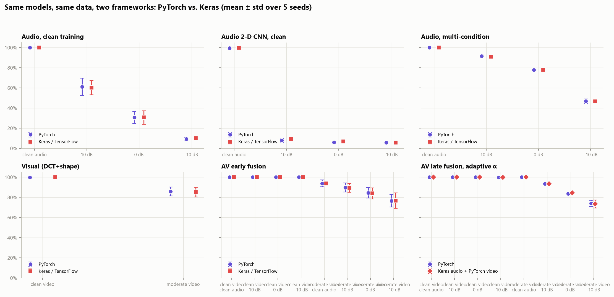

Five seeds per framework on identical inputs; all 30 system/condition pairs are in [RESULTS.md](results/tables/RESULTS.md#pytorch-vs-keras):

| System | Trainable params (both) | Hardest condition shown | PyTorch | Keras | Largest \|Δ\| over all conditions |
|---|---:|---|---:|---:|---:|
| Audio, clean training | 312,930 | 0 dB | 30.5 ± 5.9 | 30.5 ± 6.8 | 0.9 |
| Audio 2-D CNN (coursework-style) | 112,212 | 0 dB | 6.0 ± 0.9 | 6.9 ± 1.0 | 1.6 |
| Audio, multi-condition | 312,930 | 0 dB | 77.7 ± 0.6 | 77.8 ± 1.0 | 0.6 |
| Visual (DCT+shape) | 361,440 | moderate video | 85.8 ± 4.5 | 85.2 ± 4.8 | 0.7 |
| AV early fusion | 391,470 | moderate video, 0 dB | 84.5 ± 5.3 | 84.0 ± 5.5 | 0.5 |
| AV late fusion, adaptive α (Keras audio + PyTorch video) | – | moderate video, 0 dB | 83.7 ± 0.9 | 84.4 ± 1.1 | 0.7 |

Every difference is smaller than the seed-to-seed spread. Training time is not comparable: PyTorch ran on the laptop GPU, while TensorFlow has no GPU support on native Windows.

Deployment of the multi-condition audio model (single clip, CPU):

| Format | Size | Clean | 0 dB | Max logit difference to source | Latency |
|---|---:|---:|---:|---:|---:|
| PyTorch eager | 1.2 MB | 100.0 | 76.9 | – | 2.29 ms |
| ONNX Runtime | 1.2 MB | 100.0 | 76.9 | 2e-6 | 0.54 ms |
| Keras (`tf.function`) | 3.7 MB* | 100.0 | 79.0 | – | 1.63 ms |
| TFLite float32 | 1.2 MB | 100.0 | 79.0 | 4e-6 | 1.40 ms |
| TFLite float16 | 628 KB | 100.0 | 79.0 | 0.002 | 1.39 ms |
| TFLite int8 (dynamic range) | 331 KB | 100.0 | 79.0 | 0.06 | 0.39 ms |
| TFLite int8 (full integer) | 341 KB | 100.0 | 79.0 | 1.1 | 0.40 ms |

\* The `.keras` file includes the optimiser state.

* **Quantisation.** int8 quantisation shrinks the model 3.7× and speeds it up 3.6× with no change in accuracy.
* **Why the 0 dB columns differ.** PyTorch and Keras rows are different trained models (seed 0 of each framework), hence 76.9 vs 79.0 at 0 dB.

## Results in more detail

### Audio under noise
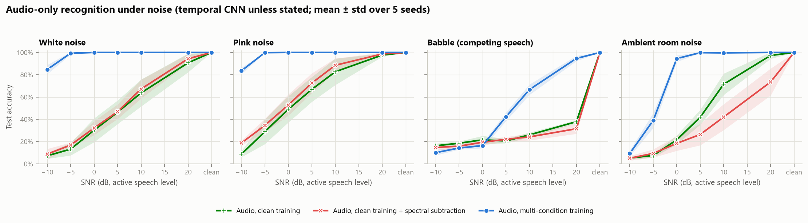

* Multi-condition training is the single most effective fix. White and pink noise become harmless down to −5 dB and room noise down to 0 dB.
* Spectral subtraction helps a little with stationary noise (pink, −10 dB: 8.7% → 18.7%). It hurts with room noise and babble, where its noise estimate is wrong.
* The [front-end ablation](results/figures/audio_frontend_ablation.png) shows, at 10 dB:
  * mel spacing beats linear spacing (60.6% vs 50.2%);
  * per-utterance CMVN doubles accuracy at 0 dB (28.0% vs 14.9%);
  * deltas matter most on a recording session from a different day and microphone (96.0% vs 90.5% for static features).

### Lip reading
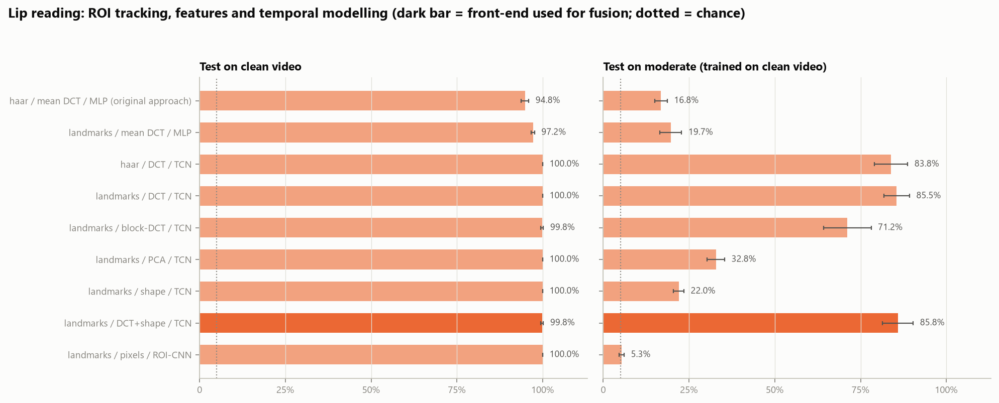

* **Tracking.** Moving from the Haar face box to landmark tracking, and from time-averaging to a temporal model, gives most of the gain.
* **Generalisation.** All front-ends are near-perfect on clean video, so the right-hand panel is the informative one:
  * the learnt ROI-CNN is the least robust, collapsing to 13% on mildly degraded video;
  * hand-crafted low-order DCT features generalise best.

<p align="center">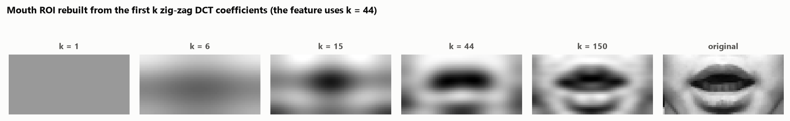</p>

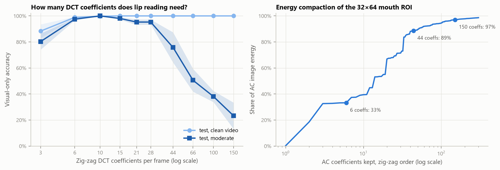

### Is the lip reader reading lips? (recording-session confound)
The 30 takes of each name were recorded consecutively (container timestamps span about 2.5 hours), so lighting and head pose drift *with the label*.

| Probe (visual front-end: landmark DCT) | accuracy | what it tests |
|---|---:|---|
| train + test on lips **at rest** before the word | 82.5% | session information exists in the video |
| model trained on the **word**, tested on rest frames | 6.1% | it did not learn a session shortcut |
| deployed full-clip model, **word masked out** | 7.5% | its decisions depend on the word |

Geometric lip-shape features carry the least session information (40% at rest vs. 83% for DCT). Cross-session generalisation of the lip reader remains untested because only one video session exists; the audio model is tested on a second session (95.8%).

### Fusion: who should be trusted, and when?
* **Clean or mild video.** Every fusion method stays at about 100% at all SNRs.
* **Moderate degradation (unseen).** The oracle weight reaches 91–100%. Early fusion and adaptive late fusion land between the two streams, and still gain about +7 dB effective SNR at 80% accuracy.
* **Severe degradation (unseen).**
  * Early fusion, which has never seen bad video, is dragged down to 30% even with clean audio.
  * A fixed weight tuned on clean video stays at 9%.
  * Adaptive weighting recovers the audio-only curve without being told anything about the video.

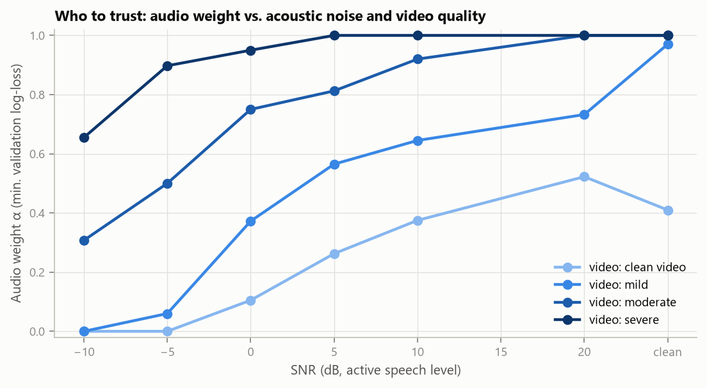

The optimal audio weight rises with SNR and with video degradation, as theory predicts. The entropy rule approximates it as long as a failing stream *knows* it is failing. Babble violates that assumption (see [the babble figure](results/figures/av_snr_curves_babble.png) and the confusion matrices below). Training the visual model with degraded video removes most of the problem: 97% at the severe level (Scenario B in RESULTS.md).

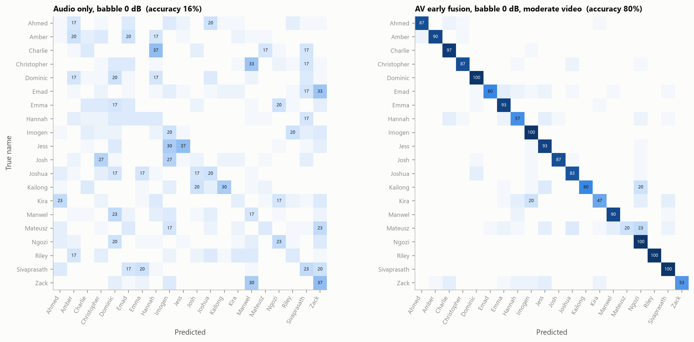

### Getting the data right
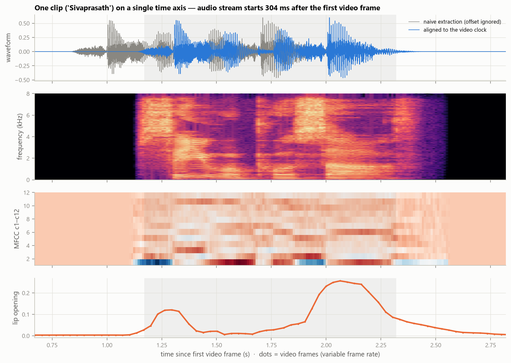

The phone's AAC stream starts 89–396 ms (mean 272 ms) after the first video frame. A plain `ffmpeg -i clip.mp4 out.wav` silently drops that offset, which would pair every sound with lip shapes about 8 frames away. The pipeline re-inserts the offset and keeps per-frame timestamps, verified against `ffprobe` to within 0.001 ms. See the [technical report](docs/technical_report.md) for the full design rationale and discussion.

## Quick start

```bash
git clone https://github.com/cpg25ncu/audio-visual-speech-recognition.git
cd audio-visual-speech-recognition
python -m venv .venv && source .venv/bin/activate        # Windows: .venv\Scripts\activate
pip install torch --index-url https://download.pytorch.org/whl/cu128   # or .../whl/cpu
pip install -e ".[landmarks,dev]"                         # add keras,export for the Keras backend
pytest                                                    # unit tests, no dataset needed
```

With the recordings available (layout in [docs/dataset.md](docs/dataset.md)) and FFmpeg on `PATH`:

```bash
curl -L --create-dirs -o data/models/face_landmarker.task \
  https://storage.googleapis.com/mediapipe-models/face_landmarker/face_landmarker/float16/1/face_landmarker.task
avsr prepare        # manifest, time-aligned audio cache, mouth tracks (~5 min)
avsr run all        # every experiment with 5 seeds (~35 min on an RTX 5060 laptop GPU)
avsr run framework_parity --backend keras   # PyTorch vs Keras parity (~30 min on CPU)
avsr run deployment --backend keras         # ONNX / TFLite export and latency
avsr report         # figures + results/tables/RESULTS.md
avsr predict path/to/clip.mp4 --noise pink --snr 0
```

## Repository layout

```
src/avsr/
  data/           manifest + fixed split; FFmpeg/OpenCV I/O with timestamps and A/V offset
  audio/          MFCC front-end, noise synthesis and SNR mixing, spectral subtraction, endpointing
  visual/         mouth tracking (face mesh / Haar), DCT / PCA / shape features, video degradation
  corpus.py       cached dataset view and feature builders for every stream
  models.py, training.py              PyTorch models and training loop
  keras_models.py, keras_training.py  Keras 3 models and training loop (same architectures and protocol)
  backends.py     one interface for both frameworks
  export.py       ONNX / TFLite export and deployment benchmark
  fusion.py       log-linear late fusion, weight selection, entropy-based adaptive weighting
  experiments.py  the experiment suite (writes results/tables/*.csv)
  report.py, report_frameworks.py, illustrate.py   every figure and table shown here
  inference.py, cli.py       avsr prepare | run | report | predict
configs/default.yaml   all parameters
tests/                 unit tests: signal processing, noise, features, fusion, models, Keras backend
docs/                  technical report and dataset notes
results/               generated tables and figures
```

## Project history and credits

This started as two pieces of coursework for the *Audio-Visual Processing* module (CMP-6026A, University of East Anglia, 2025): an audio-only recogniser, then an audio-visual one. This repository is a ground-up re-implementation and extension made in 2026. Additions over the coursework:

* timestamp-correct A/V alignment;
* landmark-based mouth tracking;
* a single temporal-CNN family for every stream, implemented in PyTorch and Keras;
* controlled noise and video-degradation protocols;
* early fusion and three kinds of late fusion;
* multi-seed evaluation;
* the confound analysis;
* model export (ONNX, TFLite), tests and CI.

* **Tongyao Liu**: design and implementation of the whole system, experiments and analysis.
* **Hanming Zhang**: recorded the training and test data.

## References

* S. Davis & P. Mermelstein, "Comparison of parametric representations for monosyllabic word recognition in continuously spoken sentences", *IEEE Trans. ASSP*, 1980.
* M. Berouti, R. Schwartz & J. Makhoul, "Enhancement of speech corrupted by acoustic noise", *ICASSP*, 1979.
* I. Matthews, T. Cootes, J. A. Bangham, S. Cox & R. Harvey, "Extraction of visual features for lipreading", *IEEE TPAMI*, 2002.
* G. Potamianos, C. Neti, G. Gravier, A. Garg & A. Senior, "Recent advances in the automatic recognition of audio-visual speech", *Proc. IEEE*, 2003.
* D. S. Park et al., "SpecAugment: a simple data augmentation method for automatic speech recognition", *Interspeech*, 2019.
* C. Lugaresi et al., "MediaPipe: a framework for building perception pipelines", 2019.

## License

Code under the MIT license. The audio-visual recordings are not distributed.
