# 噪声环境下的音视频语音识别

[English](README.md) | **简体中文**

**同时用声音和嘴唇识别说出的人名，并弄清楚嘴唇在什么时候真正有用。**
本项目从零实现了信号处理前端（MFCC 与唇部 DCT 特征），三路输入共用同一类时序卷积网络。PyTorch 和 Keras/TensorFlow 各实现了一遍，并做了结果一致性验证。评估覆盖声学噪声、训练时未见过的视频退化，以及早期融合与后期融合的对比；另外还单独分析了数据中的录制时段混杂因素。

[](https://github.com/cpg25ncu/audio-visual-speech-recognition/actions/workflows/ci.yml)


<p align="center">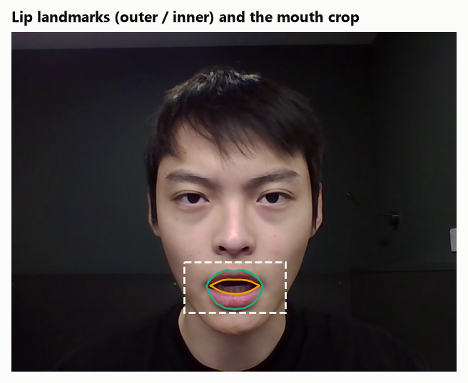
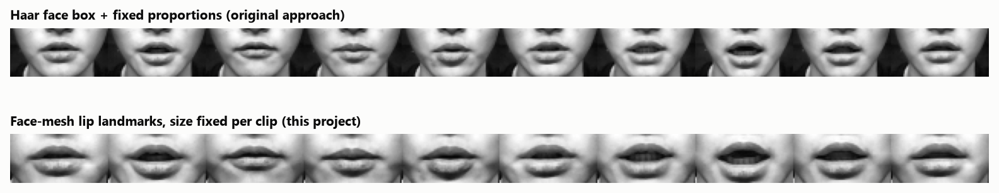</p>

**任务**：说话人相关（speaker-dependent）的孤立词识别。
- 词表：20 个英文名。
- 数据：同一说话人用手机录的 600 段音视频。
- 划分：每个名字固定按 18 / 6 / 6 分成训练集、验证集、测试集。
- 每个配置用 5 个随机种子训练，报告均值 ± 标准差。

下文所有数字都由 `avsr run all && avsr report` 生成，完整表格见 [`results/tables/RESULTS.md`](results/tables/RESULTS.md)。

## 主要结论

| | |
|---|---|
| **抗噪音频** | 多条件训练（multi-condition training）把 0 dB 信噪比下的准确率（白噪声、粉红噪声、多人说话声、室内噪声四种平均）从 **30.5% 提高到 77.7%**；谱减法只有 30.7%。多人说话声（babble）仍是难点，0 dB 时只有 16%。 |
| **读唇** | 关键点追踪的嘴部裁剪 + 二维 DCT + 时序 CNN：干净视频 **100%**；在训练时没见过的中度退化视频上 85.5%。原课程作业方案（Haar 人脸框 + 时间平均 DCT + MLP）分别只有 94.8% 和 16.8%。 |
| **系数越少越稳健** | 在退化视频上，只用 10 个 DCT 系数能达到 100%，用 150 个却只有 23%：模糊和传感器噪声破坏的恰恰是高频空间细节。 |
| **融合** | 视频质量正常时，融合系统在 **−10 dB 下仍接近 100%**，纯音频只有 47%。视频严重退化且训练中未见过时，早期融合即使音频完全干净也跌到 30%；基于熵的自适应后期融合会自动退回只用音频（干净 100%，0 dB 78%）。 |
| **自适应融合的失效场景** | 多人说话声会让音频识别器"很自信地认错"，基于熵的可靠性估计因此错误地信任音频：中度退化视频 + 0 dB 时只有 37%，而理想权重能到 87%。 |
| **混杂因素检验** | 每个名字是在一个连续时段内录完的，单看说话前静止的嘴唇就能判断属于哪个时段（83%）。但实际使用的读唇模型并没有走这条捷径：把单词片段遮掉后，准确率降到随机水平（7.5%）。 |
| **双框架** | 所有主要系统都用 **PyTorch 和 Keras/TensorFlow** 各实现并训练了一遍，两边参数量完全相同。30 组系统/条件下，两个框架的准确率最多相差 1.6 个百分点，全部落在不同随机种子之间的波动范围内。模型可导出为 ONNX 和 TFLite：int8 量化后体积缩小 3.7 倍、速度提高 3.6 倍，准确率不变。 |

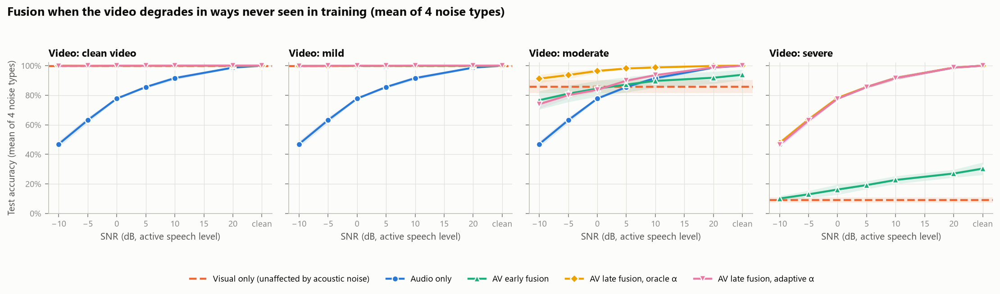

## 系统流程

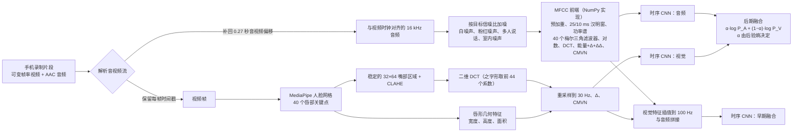

* **音频**
  * 滤波器组倒谱特征从第一性原理用 NumPy 实现，并用 librosa 做单元测试校验：梅尔滤波器组误差在 1e-5 以内。
  * 噪声按"有效语音电平"（active speech level）定义的信噪比混入。
  * 比较了三种抗噪方法：谱减法、多条件训练、倒谱均值方差归一化（CMVN）。
* **视频**
  * 手机录的是可变帧率视频，所以每一帧都按真实时间戳解码，而不是按帧号推算时间。
  * 嘴部裁剪框由人脸网格关键点稳定。
  * 特征包括外观特征（二维 DCT、分块 DCT、PCA）、几何特征（唇形）和端到端学习的特征（ROI-CNN）。
* **统一的模型族**
  * 音频、视频、融合输入都用同一种膨胀一维时序卷积网络，最后在时间维上做均值+最大值池化。这样各组对比只有输入不同，结论更干净。
  * 参数量约 0.3–0.4 M，在笔记本 GPU 上每个模型几秒就能训练完。
* **融合**
  * 早期融合：把视频上采样到音频帧率后与音频特征拼接。
  * 后期融合：对两路后验做对数线性组合，流权重有三种选法：全局固定、按条件选的理想权重（oracle）、基于熵的自适应权重。

## PyTorch 与 Keras 双框架实现

项目默认用 PyTorch。同一套模型和训练流程又用 **Keras 3（TensorFlow 后端）** 完整实现了一遍，通过 `--backend` 切换：

```bash
avsr run audio --backend keras        # 用 Keras 重跑音频实验
avsr run framework_parity --backend keras
```

* **统一接口**（[`backends.py`](src/avsr/backends.py)）
  * 特征、噪声、数据划分、评分和后期融合都只处理 NumPy 数组和后验概率，与框架无关。
  * 后端只需负责建模、训练、输出后验和保存模型。
  * 因此可以直接把 Keras 音频模型和 PyTorch 视觉模型的输出融合在一起。
* **逐层对齐**（[`keras_models.py`](src/avsr/keras_models.py)）
  * 时序 CNN、二维 CNN、MLP 的可训练参数量与 PyTorch 版完全相同，单元测试里有断言。
  * 显式处理了两个框架的差异：
    * 数据布局：通道在前 vs 通道在后；
    * BatchNorm 的 momentum 定义相反（PyTorch 0.1 = Keras 0.9）；
    * 默认初始化不同，统一为 PyTorch 的 U(±1/√fan_in)；
    * 梯度裁剪：按整体范数，而不是逐张量。
* **地道的 Keras 写法**（[`keras_training.py`](src/avsr/keras_training.py)）
  * 用 `keras.utils.PyDataset` 做每轮重新打乱，并抽取多条件版本；
  * 数据增强写成只在训练时生效的自定义层；
  * OneCycle 学习率写成 `LearningRateSchedule`，单元测试验证它与 PyTorch 的 `OneCycleLR` 逐步一致；
  * "准确率优先、平局看对数损失"的早停写成 Keras 回调。
* **部署**（[`export.py`](src/avsr/export.py)）
  * PyTorch 模型导出为 ONNX，并用 ONNX Runtime 验证数值一致；
  * Keras 模型导出为 TFLite，有 float32、float16、动态范围 int8、全整型 int8 四种。

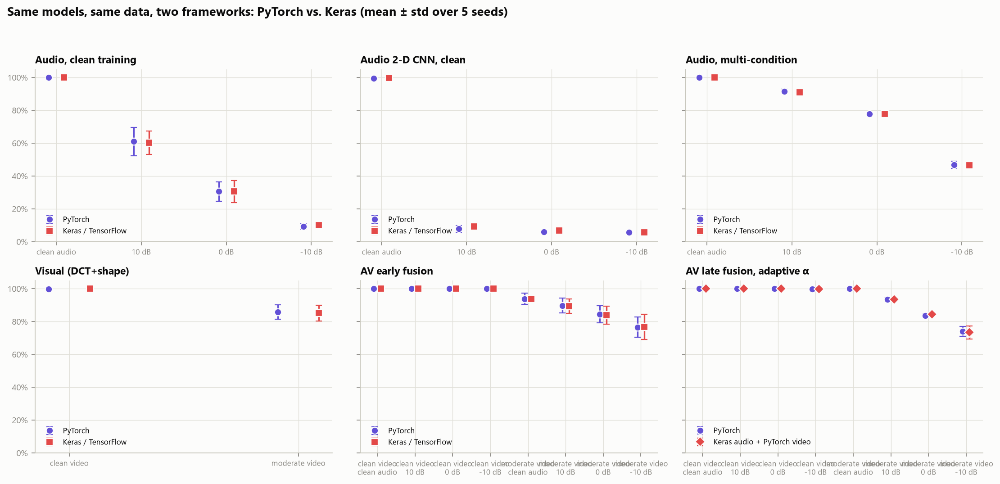

每个框架 5 个种子，输入完全相同；全部 30 组对比见 [RESULTS.md](results/tables/RESULTS.md#pytorch-vs-keras)：

| 系统 | 可训练参数（两边相同） | 展示的最难条件 | PyTorch | Keras | 所有条件下最大差值 |
|---|---:|---|---:|---:|---:|
| 音频，干净数据训练 | 312,930 | 0 dB | 30.5 ± 5.9 | 30.5 ± 6.8 | 0.9 |
| 音频二维 CNN（课程作业结构） | 112,212 | 0 dB | 6.0 ± 0.9 | 6.9 ± 1.0 | 1.6 |
| 音频，多条件训练 | 312,930 | 0 dB | 77.7 ± 0.6 | 77.8 ± 1.0 | 0.6 |
| 视觉（DCT + 唇形） | 361,440 | 中度退化视频 | 85.8 ± 4.5 | 85.2 ± 4.8 | 0.7 |
| 音视频早期融合 | 391,470 | 中度退化视频，0 dB | 84.5 ± 5.3 | 84.0 ± 5.5 | 0.5 |
| 自适应后期融合（Keras 音频 + PyTorch 视觉） | – | 中度退化视频，0 dB | 83.7 ± 0.9 | 84.4 ± 1.1 | 0.7 |

所有差值都小于不同种子之间的波动。训练时间不能直接比较：PyTorch 用的是笔记本 GPU，而 TensorFlow 在原生 Windows 上不支持 GPU。

多条件训练的音频模型在不同部署格式下的表现（单段音频，CPU）：

| 格式 | 大小 | 干净 | 0 dB | 与原框架输出的最大差 | 延迟 |
|---|---:|---:|---:|---:|---:|
| PyTorch 原生 | 1.2 MB | 100.0 | 76.9 | – | 2.29 ms |
| ONNX Runtime | 1.2 MB | 100.0 | 76.9 | 2e-6 | 0.54 ms |
| Keras（`tf.function`） | 3.7 MB* | 100.0 | 79.0 | – | 1.63 ms |
| TFLite float32 | 1.2 MB | 100.0 | 79.0 | 4e-6 | 1.40 ms |
| TFLite float16 | 628 KB | 100.0 | 79.0 | 0.002 | 1.39 ms |
| TFLite int8（动态范围） | 331 KB | 100.0 | 79.0 | 0.06 | 0.39 ms |
| TFLite int8（全整型） | 341 KB | 100.0 | 79.0 | 1.1 | 0.40 ms |

\* `.keras` 文件里还保存了优化器状态。

* **量化效果**：int8 量化让模型缩小 3.7 倍、提速 3.6 倍，准确率不变。
* **为什么 0 dB 那一列不同**：PyTorch 和 Keras 两组是分别训练的不同模型（各自框架的种子 0），所以 0 dB 下是 76.9 和 79.0。

## 详细结果

### 噪声下的音频识别
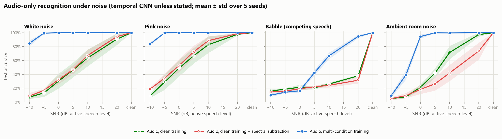

* **多条件训练效果最好**：白噪声和粉红噪声在 −5 dB 以上基本无影响，室内噪声在 0 dB 以上无影响。
* **谱减法**对平稳噪声略有帮助（粉红噪声 −10 dB：8.7% → 18.7%）。对室内噪声和多人说话声反而有害，因为这两种噪声随时间变化，从最安静的帧估出的噪声谱不准。
* [前端消融实验](results/figures/audio_frontend_ablation.png)表明：
  * 10 dB 下梅尔刻度优于线性刻度（60.6% vs 50.2%）；
  * CMVN 让 0 dB 准确率翻倍（28.0% vs 14.9%）；
  * 差分特征在另一个录制时段（不同日期、不同麦克风）上作用最大（96.0% vs 只用静态特征的 90.5%）。

### 读唇
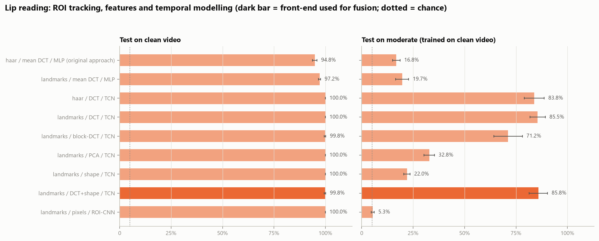

* **追踪和时序建模带来最大提升**：从 Haar 人脸框换成关键点追踪，从时间平均换成时序模型。
* **泛化能力**：所有前端在干净视频上都接近满分，所以右侧（训练未见过的退化视频）才是关键：
  * 端到端学习的 ROI-CNN 最不稳健，轻度退化时就降到 13%；
  * 手工设计的低阶 DCT 特征泛化最好。

<p align="center">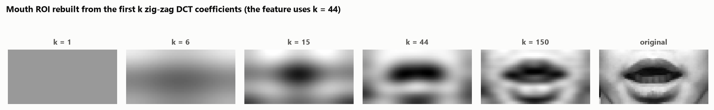</p>

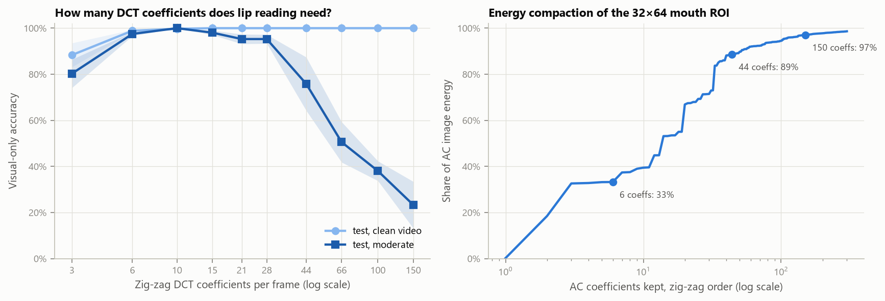

### 模型真的在读唇吗？（录制时段混杂因素）
每个名字的 30 条录音是连续录完的，容器时间戳横跨约 2.5 小时，所以光照、头部姿态会**随标签一起漂移**。

| 检验（视觉前端：关键点 DCT） | 准确率 | 检验的问题 |
|---|---:|---|
| 只用说话前**静止嘴唇**训练和测试 | 82.5% | 视频里确实含有录制时段信息 |
| 用**单词片段**训练，在静止片段上测试 | 6.1% | 模型没有学到时段捷径 |
| 实际使用的整段模型，**遮掉单词片段**后测试 | 7.5% | 模型的判断依赖单词本身 |

几何唇形特征携带的时段信息最少（静止时 40%，DCT 是 83%）。由于视频只有一个录制时段，读唇模型的跨时段泛化无法检验；音频模型在第二个录制时段上测试，准确率 95.8%。

### 融合：什么时候该信谁？
* **视频干净或轻度退化**：所有融合方法在各信噪比下都接近 100%。
* **中度退化（训练未见过）**：理想权重能达到 91–100%。早期融合和自适应后期融合介于两路之间，在 80% 准确率处仍有约 +7 dB 的有效信噪比增益。
* **严重退化（训练未见过）**：
  * 从没见过坏视频的早期融合，即使音频干净也被拖到 30%；
  * 在干净视频上调好的固定权重停留在 9%；
  * 自适应权重在完全不知道视频质量的情况下，自动恢复到纯音频的水平。

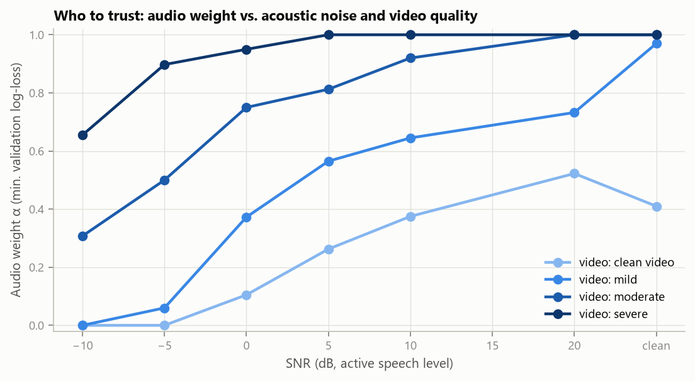

最优音频权重随信噪比升高、随视频退化而增大，与理论预期一致。基于熵的规则只要"失效的一路自己知道在失效"就能逼近最优，而多人说话声恰好违反了这一前提（见[多人说话声的结果图](results/figures/av_snr_curves_babble.png)和下面的混淆矩阵）。如果训练时就加入视频退化，这个问题基本消失：严重退化下视觉准确率仍有 97%（见 RESULTS.md 中的场景 B）。

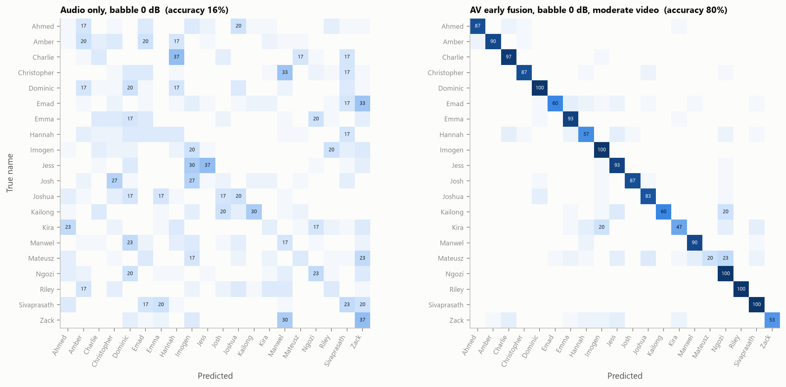

### 把数据处理对
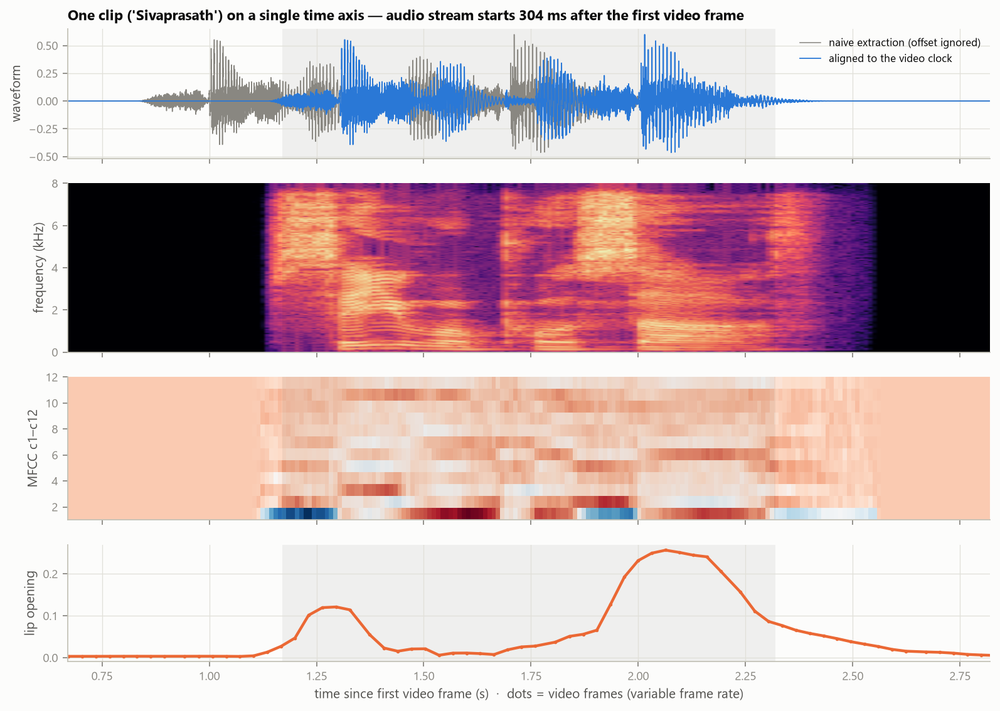

手机的 AAC 音频流比第一帧视频晚 89–396 ms 开始（平均 272 ms）。直接用 `ffmpeg -i clip.mp4 out.wav` 提取音频会悄悄丢掉这个偏移，相当于每个声音都和大约 8 帧之外的口型对应。本项目把偏移补了回来，并保留每帧的时间戳；与 `ffprobe` 读出的时间戳核对，误差小于 0.001 ms。完整的设计思路和讨论见[技术报告](docs/technical_report.md)（英文）。

## 快速开始

```bash
git clone https://github.com/cpg25ncu/audio-visual-speech-recognition.git
cd audio-visual-speech-recognition
python -m venv .venv && source .venv/bin/activate        # Windows: .venv\Scripts\activate
pip install torch --index-url https://download.pytorch.org/whl/cu128   # 或 .../whl/cpu
pip install -e ".[landmarks,dev]"                         # 需要 Keras 后端时加上 keras,export
pytest                                                    # 单元测试，不需要数据集
```

准备好录音数据（目录结构见 [docs/dataset.md](docs/dataset.md)），并把 FFmpeg 加入 `PATH` 后：

```bash
curl -L --create-dirs -o data/models/face_landmarker.task \
  https://storage.googleapis.com/mediapipe-models/face_landmarker/face_landmarker/float16/1/face_landmarker.task
avsr prepare        # 清单、对齐后的音频缓存、嘴部轨迹（约 5 分钟）
avsr run all        # 全部实验，5 个种子（RTX 5060 笔记本 GPU 约 35 分钟）
avsr run framework_parity --backend keras   # PyTorch vs Keras 一致性实验（CPU 约 30 分钟）
avsr run deployment --backend keras         # ONNX / TFLite 导出与测速
avsr report         # 生成图表和 results/tables/RESULTS.md
avsr predict path/to/clip.mp4 --noise pink --snr 0
```

## 目录结构

```
src/avsr/
  data/            数据清单与固定划分；带时间戳和音视频偏移处理的 FFmpeg/OpenCV 读写
  audio/           MFCC 前端、噪声合成与信噪比混合、谱减法、端点检测
  visual/          嘴部追踪（人脸网格 / Haar）、DCT / PCA / 形状特征、视频退化模拟
  corpus.py        数据集缓存视图与各路特征构建
  models.py, training.py              PyTorch 模型与训练循环
  keras_models.py, keras_training.py  Keras 3 模型与训练循环
  backends.py      统一的框架接口
  fusion.py        对数线性后期融合、权重选择、基于熵的自适应权重
  export.py        ONNX / TFLite 导出与部署测速
  experiments.py   全部实验（输出 results/tables/*.csv）
  report.py, report_frameworks.py, illustrate.py   本文所有图表
  inference.py, cli.py                avsr prepare | run | report | predict
configs/default.yaml   全部参数
tests/                 单元测试：信号处理、噪声、特征、融合、模型、Keras 后端
docs/                  技术报告与数据集说明
results/               生成的表格与图表
```

## 项目来历与分工

本项目最初是东英吉利大学（University of East Anglia）《音视频处理》课程（CMP-6026A，2025）的两次作业：先做纯音频识别器，再做音视频识别器。本仓库是 2026 年在此基础上的完全重写和扩展。相比原作业新增了：

* 时间戳正确的音视频对齐；
* 基于关键点的嘴部追踪；
* 统一的时序 CNN 模型族与 PyTorch / Keras 双实现；
* 可控的噪声与视频退化评估协议；
* 早期融合与三种后期融合；
* 多种子评估、混杂因素分析；
* 模型导出、测试与 CI。

* **Tongyao Liu**：整个系统的设计与实现、实验与分析。
* **Hanming Zhang**：录制训练和测试数据。

## 参考文献

* S. Davis & P. Mermelstein, "Comparison of parametric representations for monosyllabic word recognition in continuously spoken sentences", *IEEE Trans. ASSP*, 1980.
* M. Berouti, R. Schwartz & J. Makhoul, "Enhancement of speech corrupted by acoustic noise", *ICASSP*, 1979.
* I. Matthews, T. Cootes, J. A. Bangham, S. Cox & R. Harvey, "Extraction of visual features for lipreading", *IEEE TPAMI*, 2002.
* G. Potamianos, C. Neti, G. Gravier, A. Garg & A. Senior, "Recent advances in the automatic recognition of audio-visual speech", *Proc. IEEE*, 2003.
* D. S. Park et al., "SpecAugment: a simple data augmentation method for automatic speech recognition", *Interspeech*, 2019.
* C. Lugaresi et al., "MediaPipe: a framework for building perception pipelines", 2019.

## 许可证

代码采用 MIT 许可证。音视频录音数据不随仓库分发。
