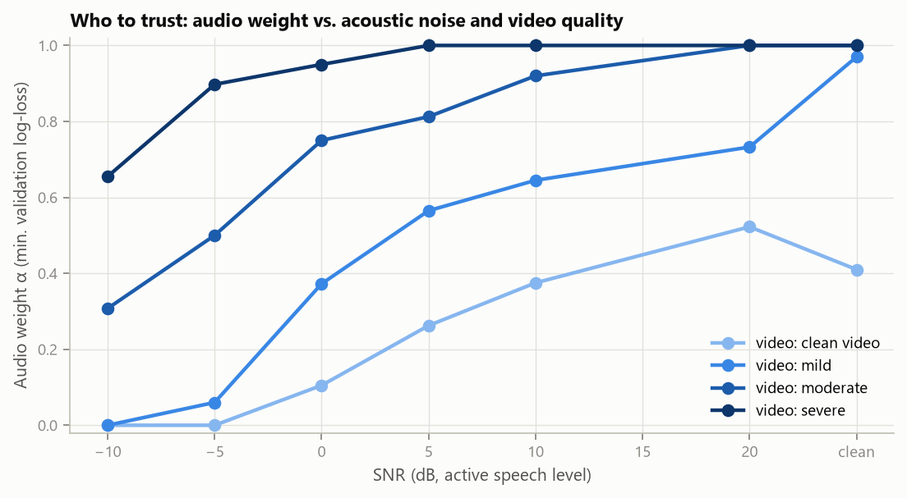

# Technical report: noise-robust audio-visual word recognition

This report explains the design decisions behind each stage, the experimental protocol and what
the results mean. Numbers quoted here are copied from `results/tables/RESULTS.md`, which is
generated from the experiment logs by `avsr report`.

**Summary.**
* Multi-condition training is the most effective acoustic noise compensation: at 0 dB it scores 77.7% against
  30.5% for clean training (mean of four noise types).
* A landmark-stabilised mouth crop with low-order DCT features and a temporal CNN reads the 20 names perfectly
  on clean video.
* Fusing the two keeps recognition at ~100% down to −10 dB SNR whenever the video is reasonable.
* When the video degrades in ways never seen in training, early fusion and fixed-weight late fusion fail badly.
  Entropy-weighted late fusion falls back to audio on its own, but it fails for babble noise, where the audio
  recogniser is confidently wrong.
* The data contain a recording-session confound. It is quantified in section 7.4, and the deployed lip reader is
  shown not to rely on it.
* The models were implemented in both PyTorch and Keras/TensorFlow. On identical inputs the two frameworks agree
  within the seed spread (section 7.6), and the models were exported to ONNX and TFLite (section 7.7).

## 1. Problem

Recognise which of 20 first names a single, known speaker says in a ~3.5 s smartphone clip, and keep
working when the audio is corrupted by noise. Speech is produced by a source (vocal folds) shaped
by a filter (vocal tract); a microphone observes the result after it has been mixed with every
other sound in the room. The lips are part of that filter and are visible, and the camera does not
hear acoustic noise. Audio carries more information (voicing, nasality, tongue position that the
lips do not show), but the video degrades independently of the audio. The aim of the project is to
measure how much each stream contributes and how to combine them.

## 2. Data handling

See [dataset.md](dataset.md) for the recordings. Three problems had to be solved before any
modelling:

**Variable frame rate.** The phone wrote frames at irregular intervals. Treating frame *k* as
time *k/fps* would stretch and squeeze lip trajectories. Every frame keeps its presentation
timestamp (validated against `ffprobe`), and features are resampled onto a uniform grid by
linear interpolation (`visual/features.py: resample`). Cubic-spline interpolation is also
implemented; for 30 Hz lip motion the difference is negligible, and linear interpolation cannot
overshoot.

**Audio/video offset.** The audio stream starts 89–396 ms after the video. The audio is decoded
with FFmpeg, then the offset is re-inserted as leading zeros so both streams share the video clock
(`data/media.py: load_aligned_audio`). Without this, early fusion would pair each sound with lip
shapes ~8 frames away. `results/figures/av_alignment.png` shows the aligned and naive waveforms
against the lip-opening trajectory.

**A stable mouth crop.** The original coursework used a Viola-Jones face box and assumed the mouth
sits at fixed proportions of it. The box jitters from frame to frame and the proportions only fit
a neutral frontal face. This project tracks the 478-point MediaPipe face mesh in video mode and
centres the crop on the 40 lip landmarks of each frame. The crop **size** is fixed per clip
(1.8 × the median mouth-corner distance), so the crop follows the mouth without "breathing" as it
opens. Centres are smoothed with a 5-frame moving average, the 32×64 grayscale crop is taken with
sub-pixel accuracy, and CLAHE equalises local contrast, which removes slow lighting differences.
Detection succeeded on 100% of frames for both methods.

## 3. Audio front-end

Implemented from first principles in NumPy (`audio/features.py`) and unit-tested against librosa
(the HTK mel filterbank matches to 1e-5; cepstra match to 1e-3 with identical conventions).

| Step | Setting | Why |
|---|---|---|
| Pre-emphasis | 0.97 | flattens the −6 dB/octave tilt of voiced speech so high-frequency formants are not swamped |
| Framing | 25 ms window, 10 ms hop | speech is quasi-stationary over ~20–30 ms; the hop gives 100 frames/s |
| Window | Hamming | reduces leakage from the frame edges at the cost of a wider main lobe |
| Spectrum | 512-point FFT, power | 31.25 Hz bin spacing at 16 kHz |
| Filterbank | 40 triangular mel channels, 0–8 kHz | matches the ear's frequency resolution and smooths away pitch harmonics, keeping the envelope (formants) |
| Log | natural log | compresses dynamic range; turns the source × filter product into a sum |
| DCT-II | keep c0–c12 | decorrelates overlapping channels; low quefrencies describe the envelope, high ones pitch detail |
| Energy | log frame energy replaces c0 | loudness contour, a strong cue for syllable structure |
| Dynamics | Δ and ΔΔ (regression over ±2 frames) | frame-wise features miss trajectories, and formant transitions identify consonants |
| Normalisation | per-utterance mean and variance | removes stationary channel effects (microphone, room) |

The ablation (section 7.2) tests every choice above: linear vs. mel spacing, triangular vs.
rectangular channels, channel count, number of cepstra, energy, deltas and CMVN.

## 4. Noise and noise compensation

**Noise types.** White and pink noise (synthetic), *babble* (six overlapping utterances of the
corpus, i.e. speech-shaped competing talkers, the hardest case) and *ambient* (a 22 s recording of
the recording room). Training and evaluation use disjoint noise material: different random draws
for synthetic noise, the first 60% vs. the last 40% of the room recording, and babble built from
training clips vs. validation/test clips (a clip never appears in its own babble).

**SNR definition.** The name occupies under a second of a ~3.5 s clip, so an SNR computed over the
whole clip would overstate the noise the listener experiences by ~5 dB. Noise is scaled to the
*active speech level*: clean-signal power averaged over frames within 30 dB of the loudest
(P.56-style). Mixing is unit-tested to hit the target SNR within 0.05 dB.

**Compensation methods compared.**
* *Spectral subtraction* (Berouti): the noise spectrum is estimated from the 10% lowest-energy
  frames; subtraction uses an SNR-dependent over-subtraction factor (4 → 1) and a 2% spectral
  floor against musical noise. The enhanced power spectrum goes straight into the filterbank.
* *Multi-condition training*: each training clip has a bank of 10 versions (clean plus nine
  random noise type/SNR draws from 20 to −5 dB), and every epoch samples one version per clip.
  The network learns noise-invariant patterns instead of having noise removed for it.
* *CMVN* (always on): normalises stationary channel differences.

## 5. Visual front-end

| Feature | Dim/frame | Idea |
|---|---:|---|
| 2D-DCT | 44 | orthonormal DCT-II of the ROI; first 44 coefficients in JPEG zig-zag order (lowest spatial frequencies = overall mouth configuration) |
| Block DCT | 96 | 8×8 tiles × 3 lowest coefficients; keeps *where* in the mouth a change happens |
| PCA ("eigenlips") | 44 | basis learnt from training frames instead of fixed cosines |
| Shape | 7 | outer/inner lip width and height, inner/outer area (shoelace formula), opening ratio, from face-mesh landmarks, normalised by the clip's median mouth width |
| DCT+shape | 51 | appearance + geometry |

Every feature gets a Δ (computed at 30 Hz, after resampling, because the regression formula
assumes uniform spacing) and per-utterance normalisation. The normalisation removes the speaker's
static appearance, so what remains is mostly *motion*. `results/figures/dct_reconstruction.png`
shows what 1, 6, 15, 44 and 150 coefficients retain, and `dct_coefficients.png` shows energy
compaction and accuracy as a function of *k*.

An end-to-end alternative, `ROI-CNN`, learns a per-frame 2-D CNN embedding of the raw crop,
followed by the same temporal network.

## 6. Recognisers and fusion

**One architecture family for all streams.** A temporal CNN (four residual 1-D convolution blocks,
kernel 5, dilations 1/2/4/8, 128 channels, batch norm, dropout) treats feature dimensions as
channels, convolves along time and pools over time with mean + max. The receptive field
(~0.6 s at 100 Hz, ~2 s at 30 Hz) covers a whole name, and pooling makes the position of the word
in the clip irrelevant. Audio, video and fused inputs differ only in channel count, so
comparisons isolate the input. The 2-D CNN of the original coursework (MFCCs treated as an image)
is kept as a baseline, and so is the original visual pipeline: time-averaged DCT followed by an MLP.

**Training.** AdamW, one-cycle learning rate (peak 1e-3), batch 32, label smoothing 0.05, up to
80 epochs with early stopping on validation accuracy (ties broken by validation log-loss once
accuracy saturates). Augmentation: random time shift, one time mask and one feature mask per
sample (SpecAugment-style). Five seeds per configuration (three for the ablations).

**Early fusion.** Visual features with their deltas are interpolated from 30 Hz onto the 100 Hz
audio frame centres (up-sampling video rather than down-sampling audio, so no acoustic detail is
lost) and concatenated with the 39 MFCCs per frame. One temporal CNN is trained on the result, with
multi-condition audio *and* video-quality augmentation. A second version, trained on clean video
only, shows what happens when the fused model has never seen bad video.

**Late fusion.** The audio and visual recognisers are trained separately and their posteriors
combined log-linearly: log P = α log P_A + (1 − α) log P_V. Three ways of choosing α:
* *global*: one α chosen on validation data across all conditions;
* *oracle*: α chosen on validation data for each noise type, SNR and video level. It needs to know
  the test condition, so it is an upper bound for any fixed weighting;
* *adaptive*: α_i = σ(a·(H_V − H_A) + b) per utterance, where H is the normalised entropy of a
  stream's posterior. A confused stream has a flat posterior and receives less weight. The two
  parameters (a, b) are fitted on validation data; at test time nothing about the noise is known.

**Video degradation.** On clean close-up video the lip reader is near-perfect for this vocabulary,
so a fusion study would only ever conclude "trust the video". Real video is worse, so the
evaluation adds a video-quality axis with four levels (clean / mild / moderate / severe). The
levels combine resolution loss (×4/×8/×16 down-sampling), sensor noise (σ = 6/12/20% of full
scale) and landmark jitter (1.5/3/6 ROI pixels): `results/figures/visual_degradation.png`.

## 7. Results and discussion

All numbers: test accuracy, mean ± std over 5 seeds (3 for the ablations), 120 test clips per condition.
Full tables: [results/tables/RESULTS.md](../results/tables/RESULTS.md).

### 7.1 Audio under noise
Clean speech is solved: every audio system scores 100%. Under noise, results are averaged over white, pink,
babble and room noise:

| System | 20 dB | 10 dB | 0 dB | −10 dB |
|---|---:|---:|---:|---:|
| clean training | 80.9 | 61.0 | 30.5 | 9.3 |
| clean training + spectral subtraction | 74.5 | 55.5 | 30.7 | 11.8 |
| multi-condition training | 98.7 | 91.6 | 77.7 | 46.9 |

* **Multi-condition training wins by a wide margin.** White and pink noise become harmless down to −5 dB.
  Room noise is handled down to 0 dB.
* **Babble is the exception.** Competing speech has the same spectral envelope and modulation as the target,
  so the network cannot learn to ignore it (16% at 0 dB).
* **Spectral subtraction** gives a small gain for stationary noise (pink at −10 dB: 8.7 → 18.7%). It loses
  accuracy for room noise and babble: their noise spectra change over time, so an estimate from the quietest
  frames is wrong where it matters, and over-subtraction removes speech.
* **The coursework-style 2-D CNN** overfits clean data (99.5% clean, 11% at 20 dB) and cannot fit
  multi-condition data within the same training budget. The temporal CNN's dilated convolutions over time,
  with features as channels, are a better inductive bias for this input.
* **Second session.** On audio recorded weeks earlier with a different microphone, the clean-trained model
  scores 95.8% and the multi-condition model 88.3%. Robustness to additive noise costs a little accuracy on
  the convolutional (channel) mismatch that CMVN handles.

### 7.2 Audio front-end ablation
On clean data every variant reaches 99.7–100%, so the differences show only under noise and session change:
* **Mel vs. linear.** Mel spacing beats linear spacing by ~10 points at 10 dB. Its narrow low-frequency bands
  resolve the first two formants, where most of the speech energy (and the SNR) is. Triangular and rectangular
  channels are equivalent after the DCT.
* **CMVN** doubles accuracy at 0 dB (28.0% vs 14.9%) by removing the noise-dependent offset of the log
  filterbank energies.
* **Deltas** matter most across sessions (96.0% with Δ+ΔΔ vs 90.5% static only). Trajectories are more
  speaker-stable than absolute spectra.
* **Channel count and cepstral order** change results by only a few points, within the seed spread (8–20
  cepstra, 20–64 channels). The defaults (40 channels, 13 cepstra) are a sound middle.

### 7.3 Lip reading
* **Clean video.** Every temporal model scores ~100%. The time-averaged baselines score 94.8–97.2%: averaging
  over 3.8 s discards the order of mouth shapes and dilutes the word with silence.
* **Degraded video, trained clean only:**
  * DCT front-ends degrade gracefully (85% at the moderate level);
  * PCA and lip shape do not (33% and 22%);
  * the end-to-end ROI-CNN is the least robust (13% at the *mild* level). A learnt pixel encoder fits
    whatever image statistics it was trained on, while low-order DCT coefficients describe only the coarse
    mouth configuration that survives blur.
* **Number of coefficients.** The DCT sweep makes this explicit: on clean video 15+ coefficients saturate. On
  moderately degraded video, 10 coefficients reach 100% while 44 reach 76% and 150 reach 23%.
* **Energy compaction.** 44 coefficients hold 89% of the AC energy of the 32×64 crop.
* **Trade-off.** k = 44 was kept as the default because it retains visibly more detail
  (`dct_reconstruction.png`). Robustness argues for k ≈ 10–20.

### 7.4 Recording-session confound
Container timestamps show that each name was recorded as one block of 30 takes over ~2.5 hours. Lighting,
head pose and camera placement therefore drift with the label, and a model could learn *when* a clip was
recorded instead of *what* was said. Probes (landmark DCT; chance 5%):

| Probe | accuracy |
|---|---:|
| train and test on the lips **at rest**, before the word (static appearance + micro-motion) | 82.5 |
| model trained on the **word segment**, tested on rest frames | 6.1 |
| deployed full-clip model, tested with the **word masked out** | 7.5 |

* Session information is clearly present.
* The models trained on speech do not respond to it: they classify rest frames at chance and fail once the
  word is removed. So they use the articulation itself.
* Lip-shape features leak least (40% at rest), DCT most (83%).
* What this design cannot show is cross-*session* lip reading, since all video comes from one sitting. The
  audio stream, tested on a second session, transfers well (95.8%).

### 7.5 Fusion
**Scenario A: video degradation unseen in training.** Mean of four noise types:

| Video | System | clean | 0 dB | −10 dB |
|---|---|---:|---:|---:|
| any | audio only | 100.0 | 77.7 | 46.9 |
| clean | early / adaptive late | 100 / 100 | 100 / 100 | 100 / 99.8 |
| moderate | visual only | 85.8 | 85.8 | 85.8 |
| moderate | early / adaptive / oracle | 93.8 / 100 / 100 | 84.5 / 83.7 / 96.4 | 76.6 / 74.0 / 91.2 |
| severe | visual only | 9.0 | 9.0 | 9.0 |
| severe | early / adaptive / oracle | 30.3 / 100 / 100 | 16.2 / 77.6 / 78.2 | 10.1 / 46.4 / 47.7 |

1. **With usable video, fusion removes the noise problem.** At clean and mild video quality every fusion
   method stays at ~100%; at 80% accuracy the gain is more than 11 dB of effective SNR.
2. **Early fusion is brittle to an unreliable stream.** Trained on clean video, it learns to lean on the
   visual features. When they become garbage, it collapses (30% with *clean* audio). Nothing in a
   concatenated feature vector tells the network which half to trust.
3. **Late fusion's value is in the weight.** A single global weight fitted on clean video stays at the visual
   stream's accuracy. The oracle weight shows the potential (91–100% at moderate quality). The entropy rule
   gets there without being told the condition, except for babble.
4. **Why the entropy rule fails for babble.** Babble is speech-like, so the audio recogniser does not become
   *uncertain*; it becomes confidently wrong, often choosing a name the babble talkers said. Its posterior
   entropy stays low, and the rule trusts it (36.7% at 0 dB with moderate video vs 86.7% for the oracle).
   This is a known weakness of confidence-based stream weighting. A reliability estimator trained to predict
   correctness, or an acoustic SNR/VAD estimate, would be the remedy.

The validation-optimal audio weight increases monotonically with SNR and with video degradation. This is the
behaviour any stream-weighting scheme should reproduce.

**Scenario B: degradation seen in training.** A visual model trained with video-quality augmentation reaches
97.3% even at the severe level, and every fusion system stays above 94%. In this single-speaker setting,
matching the training conditions to deployment matters more than the fusion method.

### 7.6 One protocol, two frameworks
The deep-learning part is implemented twice, in PyTorch (`models.py`, `training.py`) and in Keras 3 with the
TensorFlow backend (`keras_models.py`, `keras_training.py`), behind one interface (`backends.py`). Everything
else consumes NumPy arrays and posteriors, so it is shared.

**Making the two implementations comparable.** Matching layer types is not enough; the defaults differ in
ways that change training dynamics. Each difference was handled explicitly:

| Aspect | PyTorch | Keras | Resolution |
|---|---|---|---|
| layout | `(batch, channels, time)` | `(batch, time, channels)` | transpose at the backend boundary |
| batch-norm momentum | weight of the *new* statistic (0.1) | weight of the *old* statistic (0.99) | Keras momentum 0.9, epsilon 1e-5 |
| initialisation | U(±1/√fan_in) for weights and biases | Glorot-uniform weights, zero biases | custom initialisers reproducing PyTorch's |
| gradient clipping | `clip_grad_norm_` (global norm) | `clipnorm` (per tensor) | `global_clipnorm=5` |
| AdamW epsilon | 1e-8 | 1e-7 | 1e-8 |
| one-cycle schedule | `OneCycleLR` | none built in | `LearningRateSchedule` subclass, unit-tested against `OneCycleLR` |
| augmentation | function applied to the batch | – | custom layer active only when `training=True` |
| early stopping on accuracy, ties by log-loss | hand-written loop | – | callback restoring the best weights |
| multi-condition sampling | tensor indexing | – | `keras.utils.PyDataset` redrawing versions each epoch |

An earlier Keras run with framework defaults matched PyTorch on clean data but transferred worse to degraded
video (68% vs 92% on one seed). Aligning initialisation, clipping and epsilon removed the gap. Out-of-distribution
generalisation is more sensitive to implementation details than in-distribution accuracy.

**Result.** Five systems × five seeds were trained in Keras on exactly the inputs the PyTorch models saw:
* Over 30 system/condition pairs the mean accuracies differ by at most 1.6 points, every difference inside the
  seed-to-seed spread.
* Trainable-parameter counts are identical.
* Keras audio posteriors fused with PyTorch video posteriors reproduce the all-PyTorch late-fusion results
  (|Δ| ≤ 0.7).
* Training time is not comparable: PyTorch ran on a laptop GPU, while TensorFlow ≥ 2.11 has no GPU support on
  native Windows (10–14× slower on CPU).

### 7.7 Deployment
The multi-condition audio recogniser was exported from both frameworks (`export.py`):

| Format | Size | Clean | 0 dB | Max logit difference to source | Latency (1 clip, CPU) |
|---|---:|---:|---:|---:|---:|
| PyTorch eager | 1.2 MB | 100.0 | 76.9 | – | 2.29 ms |
| ONNX Runtime | 1.2 MB | 100.0 | 76.9 | 2e-6 | 0.54 ms |
| Keras, `tf.function` | 3.7 MB (incl. optimiser state) | 100.0 | 79.0 | – | 1.63 ms |
| TFLite float32 | 1.2 MB | 100.0 | 79.0 | 4e-6 | 1.40 ms |
| TFLite float16 | 628 KB | 100.0 | 79.0 | 0.002 | 1.39 ms |
| TFLite int8 (dynamic range) | 331 KB | 100.0 | 79.0 | 0.06 | 0.39 ms |
| TFLite int8 (full integer, 100-clip calibration) | 341 KB | 100.0 | 79.0 | 1.1 | 0.40 ms |

* **ONNX** reproduces PyTorch to 2e-6 and runs 4× faster than eager PyTorch for single clips.
* **Full-integer TFLite** changes logits by up to 1.1 but no decision: the model is small, its classes are well
  separated, and its activations have a narrow range.
* **Conversion route.** Full-integer calibration requires the weights to be frozen into constants. Converting
  from a traced concrete function keeps them as resource variables, so calibration fails; the model is therefore
  exported as a SavedModel with a fixed `(1, T, D)` signature before conversion.

## 8. Limitations
* **One speaker, one video session, 600 clips.** The results describe speaker-dependent recognition of a
  closed 20-word vocabulary. They do not show speaker-independent lip reading.
* **Simulated degradations.** Noise is added digitally rather than recorded (except the room noise), and
  video degradation is a controlled simulation (resolution, sensor noise, landmark jitter), not real far-field
  or low-light footage.
* **Same-talker babble.** Babble is built from the same speaker's other utterances, which is harder than
  multi-talker babble in one way (identical voice) and easier in another (closed vocabulary).
* **Oracle endpoints in the confound probes.** Speech endpoints come from clean audio; this affects only the
  analysis, never recognition.

## 9. What I would do next
* Record a second video session, on a different day and preferably with a second speaker, to measure
  cross-session and speaker-independent lip reading directly.
* Replace entropy with a learnt reliability model, e.g. a small network predicting each stream's
  correctness from posterior statistics and an SNR estimate, and test it on babble.
* Train end-to-end AV models with modality dropout, so that early fusion learns to cope with a missing or
  corrupted stream.
* Move from isolated words to connected speech (CTC), where the visual stream's ability to separate
  confusable consonants matters more.

